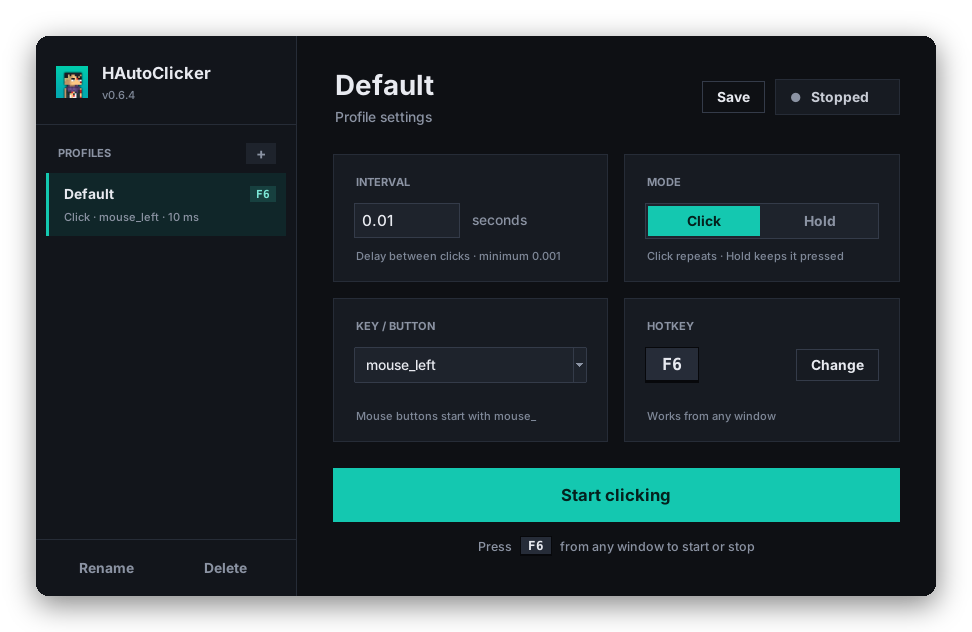
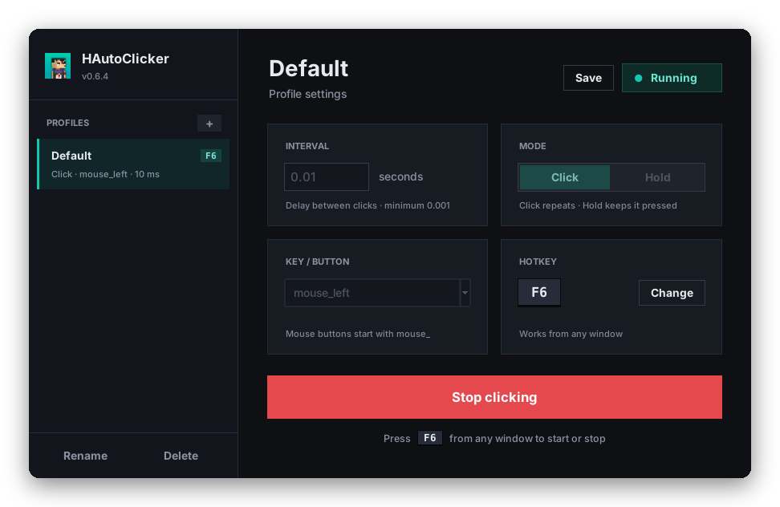

# HAutoClicker (HAC)

A fast, lightweight autoclicker for Windows and Linux, built with Python and Tkinter. Pick a key or mouse button, set the interval, and start or stop from any window with a single hotkey.

[](LICENSE)
[](https://github.com/JMF-Alex/HAC/stargazers)
[](https://github.com/JMF-Alex/HAC/issues)




## Table of Contents

1. [Features](#features)
2. [Getting Started](#getting-started)
   * [Prerequisites](#prerequisites)
   * [Installation](#installation)
3. [Usage](#usage)
4. [Configuration](#configuration)
5. [Building an Executable](#building-an-executable)
6. [Project Structure](#project-structure)
7. [Roadmap](#roadmap)
8. [Contributing](#contributing)
9. [License](#license)
10. [Acknowledgments](#acknowledgments)

## Features

- **Two modes**: *Click* repeats the key or button at your interval, *Hold* keeps it pressed until you stop.
- **Flexible intervals**: from 0.001 seconds (1 ms) up to one hour.
- **Any target**: the left, right or middle mouse button, or a keyboard key (letters, arrows, `space`, `shift`, `ctrl`, `alt`, `enter`, `tab`).
- **Global hotkey**: `F6` by default, works from any window, and can be changed in one click.
- **Settings that stick**: your configuration is saved and restored on the next launch.
- **Safe by design**: settings are locked while clicking, and a held key is released when you close the app.
- **Modern dark interface**: flat dark theme with a matching title bar on Windows 10 and 11.
- **Profiles sidebar**: the interface is ready for it, but managing profiles is not implemented yet (see the [Roadmap](#roadmap)).

## Getting Started

### Prerequisites

- Windows 10 or 11. Mouse clicks are sent through the Windows API, so HAC does not run on Linux or macOS.
- [Python 3](https://www.python.org/downloads/) with Tkinter. Tkinter is included in the official Windows installer.
- The [`keyboard`](https://github.com/boppreh/keyboard) library:

```bash
pip install keyboard
```

### Installation

1. Clone the repository:

```bash
git clone https://github.com/JMF-Alex/HAC.git
```

2. Enter the project directory:

```bash
cd HAC
```

3. Run the app:

```bash
python main.py
```

## Usage

1. Set the **interval** between clicks, in seconds. For example, `0.01` is one click every 10 ms.
2. Choose the **mode**.
3. Choose the **key or button** to press.
4. Click **Start clicking**, or press the hotkey (`F6` by default).
5. Click **Stop clicking**, or press the hotkey again, to stop.



While HAC is running, the interval, mode and key are locked so that what you see is what is being sent. The status badge in the top right turns green, and the main button turns red.

| Mode  | What it does                                                           |
| ----- | ---------------------------------------------------------------------- |
| Click | Presses and releases the key or button once per interval.              |
| Hold  | Presses the key or button and keeps it down until you stop. The interval is ignored. |

### Changing the hotkey

Click **Change**, then press the key you want. The new hotkey is saved right away.

The hotkey is global, so it also fires while you type in other programs. Pick a key you do not use during that time, such as one of the `F` keys, and avoid letters.

### Tips

- If the program you want to click in runs as administrator, start HAC as administrator too. Windows blocks input from a normal program to an elevated one.
- Mouse buttons are named `mouse_left`, `mouse_right` and `mouse_middle`. The plain `left` and `right` entries are the keyboard arrow keys.
- Values outside the allowed interval range are corrected automatically to the nearest limit.

## Configuration

HAC stores its settings in `%APPDATA%\HAutoClicker\config.json`, next to a `hac.log` file that records errors. You do not need to edit the file by hand, but you can:

```json
{
    "version": 2,
    "interval": 0.01,
    "hotkey": "F6",
    "mode": "Click",
    "target_key": "mouse_left"
}
```

| Key          | Meaning                                         | Valid values                                                           |
| ------------ | ----------------------------------------------- | ---------------------------------------------------------------------- |
| `interval`   | Seconds between clicks                          | `0.001` to `3600`                                                      |
| `hotkey`     | Key that starts and stops the clicker           | A key name, for example `F6`                                           |
| `mode`       | How the key or button is pressed                | `Click` or `Hold`                                                      |
| `target_key` | What is pressed                                 | `mouse_left`, `mouse_right`, `mouse_middle`, `a` to `z`, `space`, `shift`, `ctrl`, `alt`, `enter`, `tab`, `up`, `down`, `left`, `right` |

Invalid or missing values fall back to the defaults, and a corrupted file never stops the app from starting. Settings from older versions (`hac_config.json` in your home folder) are migrated automatically.

## Building an Executable

You can package HAC into a single `.exe` with [PyInstaller](https://pyinstaller.org/):

```bash
pip install pyinstaller
pyinstaller --onefile --windowed --icon assets/icon.ico --add-data "assets;assets" --name HAutoClicker main.py
```

The result is written to `dist/HAutoClicker.exe`.

## Project Structure

```text
HAC/
├── main.py              Entry point (sets up logging and starts the app)
├── assets/
│   └── icon.ico         Application icon
├── core/                Clicker engine, key simulation and settings
├── gui/                 Tkinter interface: theme, widgets and controller
└── docs/images/         Screenshots used in this README
```

## Roadmap

- [x] Save and restore settings
- [x] Dark redesign with a profiles sidebar
- [ ] Profile management: create, rename, delete and switch profiles
- [ ] Per-profile settings: hotkey, interval, key and mode

## Contributing

Contributions are welcome!

1. Fork the repository
2. Create a new branch (`git checkout -b feature/MyFeature`)
3. Commit your changes (`git commit -m "Add new feature"`)
4. Push to your branch (`git push origin feature/MyFeature`)
5. Open a Pull Request

## License

Distributed under the MIT license.

See the [`LICENSE`](LICENSE) file for more information.

## Acknowledgments

- Base template inspired by [Othneil Drew's Best-README-Template](https://github.com/othneildrew/Best-README-Template)
- README Generated with [README-Generator](https://github.com/JMF-Alex/README-Generator)
- Developed by [JMF-Alex](https://github.com/JMF-Alex)
