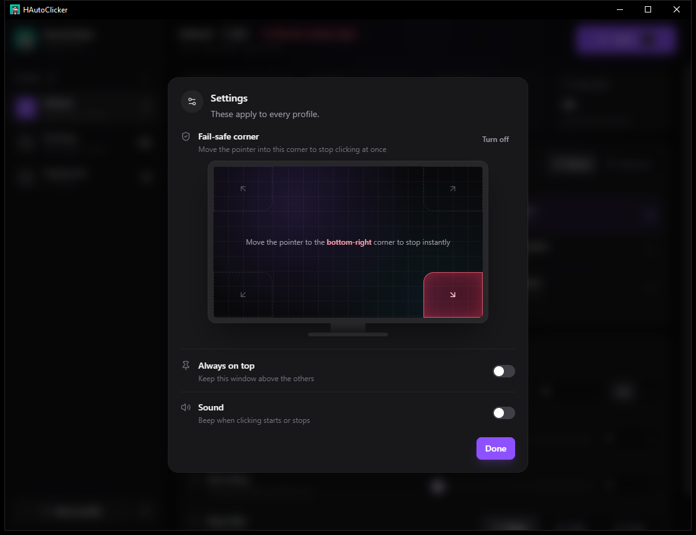

# HAutoClicker (HAC)

A fast, lightweight autoclicker for Windows, built with Rust and Tauri. Pick a mouse button or a key, set the interval, and start or stop from any window with a single hotkey.

This is the Rust rewrite of the original Python HAC. It reads the same settings file, so your existing profiles carry over.

[](https://github.com/JMF-Alex/hac)
[](https://github.com/JMF-Alex/hac/stargazers)
[](https://github.com/JMF-Alex/hac/issues)


## Table of Contents

1. [Features](#features)
2. [Getting Started](#getting-started)
   * [Prerequisites](#prerequisites)
   * [Installation](#installation)
3. [Usage](#usage)
4. [Configuration](#configuration)
5. [Building an Executable](#building-an-executable)
6. [Running the Tests](#running-the-tests)
7. [Project Structure](#project-structure)
8. [Roadmap](#roadmap)
9. [Contributing](#contributing)
10. [License](#license)
11. [Acknowledgments](#acknowledgments)

## Features

- **Two modes**: *Click* repeats the key or button at your interval, *Hold* keeps it pressed until you stop.
- **Flexible intervals**: from 1 ms up to one hour, typed in milliseconds or seconds, with one-click presets and optional random variation.
- **Visual pickers**: choose the target on a drawn mouse (left, middle or right button) or a keyboard (letters, `Space`, `Shift`, `Ctrl`, `Alt`, `Enter`, `Tab` and the arrows).
- **Live session stats**: click counter, clicks per second, elapsed time and a progress bar towards the stop limit.
- **Profiles**: create, rename, duplicate and delete profiles. Each one has its own settings and its own global hotkey.
- **Global hotkeys**: `F6` by default, work from any window. Pressing another profile's hotkey switches to it and starts it.
- **Stop after**: stop automatically after a number of clicks or seconds, and add a countdown before the first click.
- **Fail-safe corner**: pick a corner on the screen drawing; moving the mouse into it stops clicking at once.
- **Settings that stick**: every change is saved right away and restored on the next launch.
- **Safe by design**: settings are locked while clicking, a held key is released when you close the app, and keys sent by other programs never trigger your hotkey.
- **Small and native**: a single `.exe` of about 9 MB, using the WebView2 runtime that ships with Windows.

## Getting Started

### Prerequisites

- Windows 10 or 11 with the [WebView2 runtime](https://developer.microsoft.com/microsoft-edge/webview2/) (already installed on Windows 11 and up-to-date Windows 10).
- [Rust](https://rustup.rs/) (stable, MSVC toolchain).
- [Visual Studio Build Tools](https://visualstudio.microsoft.com/visual-cpp-build-tools/) with the **Desktop development with C++** workload.
- [Node.js 20+](https://nodejs.org/) and [pnpm](https://pnpm.io/installation).

### Installation

1. Clone the repository and enter it:

```bash
git clone https://github.com/JMF-Alex/hac.git
cd hac
```

2. Install the frontend dependencies:

```bash
pnpm install
```

3. Run the app in development mode (starts Vite and the app, with live reload):

```bash
pnpm tauri dev
```

## Usage

1. Choose the **action** (*Click* or *Hold*) and the **target** button or key.
2. Set the **interval** under **Timing**. For example, `10 ms` is 100 clicks per second.
3. Click **Start**, or press the profile's hotkey (`F6` by default).
4. Click **Stop**, or press the hotkey again, to stop.



While HAC is running, the profile's settings are locked so that what you see is what is being sent. The status badge turns green, the main button turns red, and the session stats update live.

| Mode  | What it does                                                                          |
| ----- | ------------------------------------------------------------------------------------- |
| Click | Presses and releases the key or button once per interval.                             |
| Hold  | Presses the key or button and keeps it down until you stop. The interval is ignored. |

Each profile's settings fit on one page:

| Section  | What it holds                                                         |
| -------- | --------------------------------------------------------------------- |
| Action   | Click or Hold, and the profile's hotkey.                              |
| Target   | The mouse button or key to press, picked on a drawing of the device.  |
| Timing   | Interval, random variation, start delay and stop condition.           |

The fail-safe corner, always on top and sound apply to every profile, so they live in **Settings** (the gear next to *New profile*). When the fail-safe is on, a chip in the top bar shows its corner.

### Changing the hotkey

In the **Action** section, click **Record**, then press the key you want. Press `Esc` to keep the current one. The new hotkey is saved right away.

The hotkey is global, so it also fires while you type in other programs. Pick a key you do not use during that time, such as one of the `F` keys, and avoid letters.

### Tips

- If the program you want to click in runs as administrator, start HAC as administrator too. Windows blocks input, and hotkeys, between a normal program and an elevated one.
- Hover a profile in the sidebar to rename, duplicate or delete it.
- Values outside the allowed range are corrected automatically to the nearest limit.

## Configuration

HAC stores its settings in `%APPDATA%\HAutoClicker\config.json`. Set the `HAC_CONFIG_DIR` environment variable to use another folder. You do not need to edit the file by hand, but you can:

```json
{
  "version": 5,
  "active_profile": "Default",
  "profiles": {
    "Default": {
      "interval": 0.01,
      "hotkey": "F6",
      "mode": "Click",
      "target_key": "mouse_left",
      "jitter": 0.0,
      "limit_kind": "Never",
      "limit_value": 100.0,
      "start_delay": 0.0
    }
  },
  "settings": {
    "failsafe": "Off",
    "always_on_top": false,
    "sound": false
  }
}
```

| Key           | Meaning                                    | Valid values                                                           |
| ------------- | ------------------------------------------ | ---------------------------------------------------------------------- |
| `interval`    | Seconds between clicks                     | `0.001` to `3600`                                                      |
| `hotkey`      | Key that starts and stops this profile     | A key name, for example `F6`, or empty for none                        |
| `mode`        | How the key or button is pressed           | `Click` or `Hold`                                                      |
| `target_key`  | What is pressed                            | `mouse_left`, `mouse_right`, `mouse_middle`, `a` to `z`, `space`, `shift`, `ctrl`, `alt`, `enter`, `tab`, `up`, `down`, `left`, `right` |
| `jitter`      | Random variation of each delay, in percent | `0` to `100`                                                           |
| `limit_kind`  | When to stop on its own                    | `Never`, `Clicks` or `Time`                                            |
| `limit_value` | Clicks or seconds for the limit            | `1` to `1000000`                                                       |
| `start_delay` | Countdown before the first click, seconds  | `0` to `60`                                                            |
| `failsafe`    | Screen corner that stops clicking          | `Off`, `Top-left`, `Top-right`, `Bottom-left`, `Bottom-right`          |

Invalid or missing values fall back to the defaults, and a corrupted file never stops the app from starting. Settings from older versions (including `hac_config.json` in your home folder) are migrated automatically.

## Building an Executable

```bash
pnpm tauri build --no-bundle   # a single target/release/hac.exe
pnpm tauri build               # also builds .msi and setup .exe installers in target/release/bundle/
```

The plain `hac.exe` runs with a double click and needs no installation. The installers add a Start menu entry and an uninstaller, and install WebView2 if it is missing.

Always build through `pnpm tauri build`. A plain `cargo build --release` produces an exe that expects the development server and opens a blank window.

## Running the Tests

```bash
cargo test     # Rust: config, profiles, clicker engine, fail-safe and formatting
pnpm build     # TypeScript type-check and frontend build
```

The Rust tests live next to the code they test, in a `#[cfg(test)] mod tests` block at the end of each file.

## Project Structure

```text
hac/
├── src/                         Rust backend
│   ├── main.rs                  Entry point: registers the commands and starts the app
│   ├── app/                     Ties the clicker, config, hotkeys and window together
│   │   ├── mod.rs               Controller: app state, status line, fail-safe loop
│   │   ├── commands.rs          The commands the window calls
│   │   └── format.rs            Status-line text (durations, click counts)
│   ├── core/                    Everything that works without Windows
│   │   ├── constants.rs         Limits and choices shared by the app
│   │   ├── engine/              Clicker thread and fail-safe corner check
│   │   └── storage/             Config file, profile names and app folders
│   └── platform/                Windows access
│       ├── hotkeys.rs           Global hotkeys through Raw Input
│       ├── input.rs             Simulated clicks and key presses (SendInput)
│       └── system.rs            Pointer position, beep and timer resolution
├── ui/                          React + Tailwind CSS 4 frontend
│   ├── main.tsx, App.tsx        Entry point and window layout
│   ├── api.ts                   Typed calls to the Rust side and live state
│   ├── lib/cx.ts                Class-name helper
│   └── components/
│       ├── ui/                  Building blocks (Button, Panel, Switch, Slider...)
│       ├── layout/              Sidebar, top bar and session stats
│       ├── profile/             The profile page: Action, Target and Timing panels
│       ├── pickers/             Mouse, keyboard, mode and screen-corner pickers
│       └── dialogs/             Settings, name and confirmation dialogs
├── icons/icon.ico               Application icon
├── tauri.conf.json              Window and bundle settings
└── docs/images/                 Screenshots used in this README
```

## Roadmap

- [x] Rewrite in Rust with Tauri, keeping the Python settings file
- [x] Redesigned interface with visual pickers and live session stats
- [x] Profile management: create, rename, duplicate, delete and switch profiles
- [x] Click and time limits, start delay and random variation
- [x] Fail-safe corner, always on top and sound
- [ ] Linux support
- [ ] Mouse side buttons as targets and hotkeys

## Contributing

Contributions are welcome!

1. Fork the repository
2. Create a new branch (`git checkout -b feature/MyFeature`)
3. Commit your changes (`git commit -m "Add new feature"`)
4. Push to your branch (`git push origin feature/MyFeature`)
5. Open a Pull Request

## License

Distributed under the MIT license.

## Acknowledgments

- Base template inspired by [Othneil Drew's Best-README-Template](https://github.com/othneildrew/Best-README-Template)
- README Generated with [README-Generator](https://github.com/JMF-Alex/README-Generator)
- Developed by [JMF-Alex](https://github.com/JMF-Alex)
